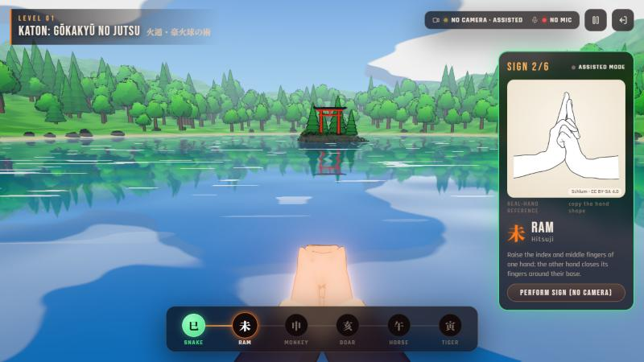
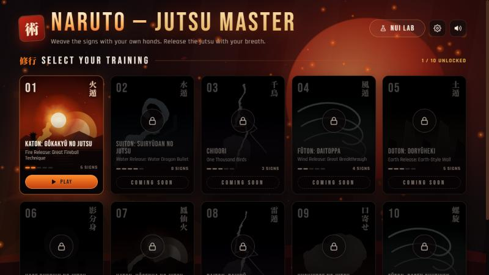
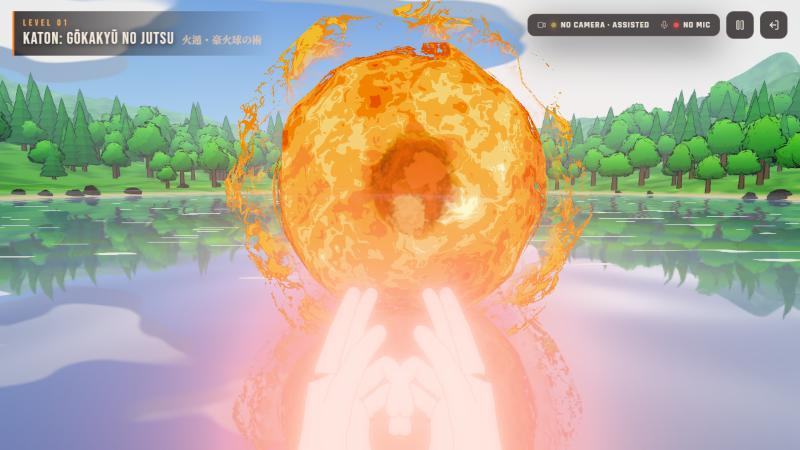
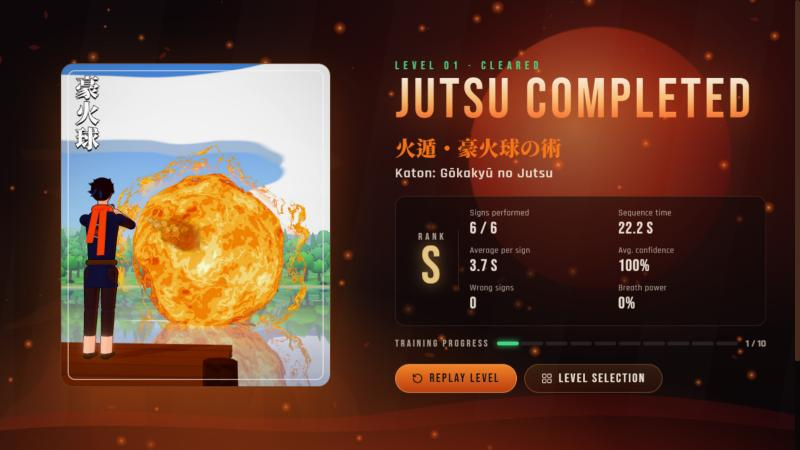
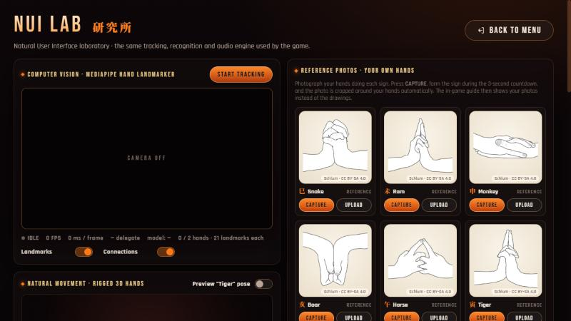

# NARUTO — JUTSU MASTER

**Juego web 3D controlado con las manos** · Proyecto de *Desarrollo de Interfaces* — **Interfaces Naturales de Usuario (NUI)** · CEAC FP · DAM2

Haces los sellos de un jutsu con **tus manos reales** delante de la webcam, las manos 3D del
personaje copian tus movimientos en tiempo real, y liberas la **Gran Bola de Fuego**
(*Katon: Gōkakyū no Jutsu*) **soplando al micrófono**. Todo funciona en el navegador, sin
servidor y sin enviar la imagen de la cámara a ningún sitio.

<p align="center">
  
</p>

| Menú | Bola de fuego |
| --- | --- |
|  |  |
| **Nivel completado** | **NUI LAB** |
|  |  |

## Qué hace

- **Reconocimiento de gestos con la webcam** — MediaPipe Hand Landmarker detecta 21 puntos por
  mano (dos manos). Un motor propio analiza la flexión de cada dedo, compara con plantillas de
  los 6 sellos (Serpiente, Carnero, Mono, Jabalí, Caballo, Tigre), calcula una confianza,
  exige mantener el sello unos instantes (máquina de estados) y da pistas para corregirlo.
- **Manos 3D que copian las tuyas** — manos con esqueleto (16 huesos) reconstruidas a partir de
  los puntos de MediaPipe, con suavizado One Euro, detección geométrica de mano izquierda/derecha,
  rechazo de fallos de seguimiento y una "ayuda de sello" que coloca las manos en el sello limpio
  cuando estás cerca de conseguirlo.
- **Soplo al micrófono** — la Web Audio API distingue un soplo de la voz o de un aplauso
  (nivel, planitud espectral, energía en graves y duración).
- **Mundo 3D en estilo anime** — Three.js con sombreado *cel*, contornos de tinta, cielo con
  nubes, lago con reflejos reales, bosque, torii, y una bola de fuego hecha con shaders y
  partículas. Todo generado por código (sin modelos 3D externos).
- **Integración con un vídeo propio** — el nivel puede reproducir tu clip del anime, pausarlo en
  el fotograma exacto, hacer zoom hacia el personaje, pasar a la parte jugable y continuar el
  vídeo desde el mismo punto. Sin vídeo, se usa una cinemática 3D original.
- **NUI LAB** — laboratorio para la demostración: seguimiento en directo, manos 3D, confianza de
  cada sello, medidor de soplo y captura de fotos de referencia de tus propias manos.
- **Modo asistido** — si no hay cámara o micrófono, se puede jugar con botones.

## Tecnologías

| Parte | Tecnología |
| --- | --- |
| Lenguaje | TypeScript 5.9 |
| Interfaz | React 19 |
| 3D | Three.js r187 (WebGL, shaders GLSL propios, post-procesado) |
| Visión por computador | Google MediaPipe Tasks Vision — Hand Landmarker (GPU, local) |
| Audio | Web Audio API (detección de soplo, música y efectos generados por código) |
| Herramientas | Vite 8, Vitest 5 (43 tests automáticos) |

## Cómo ejecutarlo

Necesitas **Node.js 20+** y un navegador basado en Chromium (Chrome / Edge) con webcam.

```bash
npm install          # instala dependencias y copia los ficheros WASM de MediaPipe
npm run dev          # abre http://localhost:5173
```

Otros comandos: `npm test` (tests), `npm run build` (versión de producción en `dist/`),
`npm run fetch-model` (descarga el modelo de manos para usarlo sin conexión).

> El navegador pedirá permiso para la **cámara** y el **micrófono**. Si no funcionan, el juego
> muestra una lista de pasos para solucionarlo (permisos del navegador y de Windows). Las vistas
> previas integradas de algunos editores bloquean la cámara: abre el juego en Chrome o Edge.

### Vídeo opcional

El vídeo del anime **no está incluido** en este repositorio (tiene copyright). Si tienes tu
propio clip, guárdalo como `public/assets/videos/level1.mp4` o elígelo desde
**Ajustes → Vídeo**, y ajusta allí los puntos de pausa y reanudación.

## Aviso

Proyecto académico hecho por un fan, sin relación con los propietarios de la serie. Los
personajes 3D, el escenario, la música y los efectos son originales y se generan por código.
Los dibujos de referencia de los seis sellos son de *Schlum* (Wikimedia Commons,
licencia CC BY-SA 4.0) y se acreditan en el juego y en `public/assets/signs/ATTRIBUTION.md`.

---

## Technical documentation (English)

Gesture-controlled 3D web game — **Development of User Interfaces · Natural User Interfaces (NUI)** project.

You perform the hand signs of a jutsu with your **real hands** in front of the webcam
(MediaPipe Hand Landmarker, 21 landmarks per hand, both hands), the first-person 3D hands
reproduce your movements in real time, and you release the **Great Fireball** by
**blowing into the microphone** (Web Audio API).

> Fan-made academic project, not affiliated with the original series. All 3D characters,
> artwork, music and sound effects are original and generated procedurally, except the six
> hand-sign reference drawings (see *Credits*). The anime clip is **your own asset** (see below)
> and is only loaded locally.

## 1. Quick start

Requirements: **Node.js 20+** and a Chromium-based browser (Chrome / Edge recommended) with a webcam and a microphone.

```bash
npm install
```

```bash
npm run dev
```

Open **http://localhost:5173**. `localhost` counts as a secure context, so the browser allows camera and microphone access.

| Command | What it does |
| --- | --- |
| `npm run dev` | Development server (hot reload) |
| `npm run build` | Type-check + production build into `dist/` |
| `npm run preview` | Serve the production build |
| `npm test` | Unit tests of the gesture engine and blow detector (17 tests) |
| `npm run fetch-model` | *Optional*: download the hand model into `public/models/` for fully offline use |

`npm install` also copies the MediaPipe WASM runtime into `public/mediapipe/wasm` (postinstall script), so only the model file (~7.8 MB) is fetched from Google's MediaPipe storage at first use, unless you ran `npm run fetch-model`.

---

## 2. Assets you provide

| File | Required? | Purpose |
| --- | --- | --- |
| `public/assets/videos/level1.mp4` | Recommended | The original scene (father and son, Great Fireball lesson). Without it, Level 1 plays an **original 3D cinematic** instead — the game is never left empty. |
| `public/assets/signs/<sign>.jpg` | Optional | Photos of hands doing each sign (`snake`, `ram`, `monkey`, `boar`, `horse`, `tiger`; .jpg/.png/.webp). Easier: take them in **NUI LAB → Reference photos**. |
| `public/assets/images/level1-completion.png` | Optional | Replaces the original artwork on the *JUTSU COMPLETED* screen. |
| `public/assets/audio/menu-theme.mp3` | Optional | Replaces the procedural menu music. |
| `public/assets/audio/level-theme.mp3` | Optional | Replaces the procedural in-level music. |

You can also pick a video at runtime: **Main menu → ⚙ Settings → Video → CHOOSE LOCAL MP4…** (any format the browser can play: MP4/H.264, WebM…).

### Video timestamps

Set them once for your clip, either in code or from the UI:

* **Code**: `src/game/levels/Level1/config.ts` → `video`:
  * `introStart` – where the intro starts (s)
  * `pauseAt` – the exact moment the character is about to perform the jutsu (s)
  * `resumeAt` – where the video continues after gameplay (`null` = exactly where it paused)
  * `endAt` – where the ending stops (`null` = end of the file)
  * `focus` – point of the frame the camera zooms into (0..1) and the zoom amount
* **UI**: *Settings → Video*: scrub the preview, press **⟵ NOW** next to each field, and click on the character in the frame to set the zoom focus. These values override the config and are saved in the browser.

The flow uses **one `<video>` element** for both segments. It pauses frame-accurately at `pauseAt` (`requestVideoFrameCallback`), stores `currentTime`, and after gameplay resumes from that stored position, with no reload or restart of the file.

---

## 3. How to play Level 1 — *Katon: Gōkakyū no Jutsu*

1. **Menu** → Level 1 → cinematic transition.
2. **Introduction**: your video plays (or the 3D cinematic) and pauses right before the jutsu. The camera zooms into the character and you enter **first person**. You can press **SKIP** during the intro.
3. **Chakra sensors**: allow the camera and the microphone.
4. **Hand signs** (hold each one still until the ring fills):

| # | Sign | Game version (designed to be distinguishable by a single webcam) |
| --- | --- | --- |
| 1 | 巳 Snake | Hands clasped, fingers interlocked, pointing up. |
| 2 | 未 Ram | One hand raises index + middle fingers; the other hand closes its fingers around their base. |
| 3 | 申 Monkey | Both hands flat and sideways, one laid on top of the other, pointing the same way. |
| 4 | 亥 Boar | Wrists bent so both hands point **down**, fingers folded, knuckles pressed together. |
| 5 | 午 Horse | Index fingertips touching in a triangle pointing up; the other fingers folded and interlocked. |
| 6 | 寅 Tiger | Index + middle fingers of both hands raised and pressed together, the others interlocked. |

   **Tip — reference photos:** open **NUI LAB → Reference photos**, press **CAPTURE** for each sign and form it with your hands during the 3-second countdown. The photo is cropped around your hands automatically (mirror view) and the in-game guide shows *your own photos* instead of the drawings. You can also upload pictures or put them in `public/assets/signs/`.

   The floating guide shows your photo of the sign, or otherwise a drawn reference (SVG, **mirror view** like the webcam preview: blue cuff **L** = your left hand, orange cuff **R** = your right hand), its name, `SIGN n/6`, the status (*form the sign / hold still / confirmed*), a confidence ring with the threshold mark, a stability ring, correction hints (*"Fold your right ring finger"*, *"Touch your index fingertips together"*…) and a warning if you perform a different sign.
5. **Breath**: the hands come to the mouth — *TAKE A BREATH… AND RELEASE THE FIRE!* — **blow steadily into the microphone** (about a third of a second). A live meter shows the intensity.
6. **Great Fireball** → impact → camera pulls back to third person → your video resumes exactly where it stopped → **JUTSU COMPLETED** (Replay / Level selection).

Tips: sit about an arm's length from the webcam, light in front of you, both hands inside the frame. If the lab shows your right hand as LEFT, enable *Swap left/right hands*.

Fallbacks (never the primary interaction): if no camera is available you can continue in a clearly labelled **assisted mode** (click to perform each sign; the virtual hands then form that sign); if the microphone is unavailable or silent, a **RELEASE FIRE** button appears.

Keyboard: **Esc** = pause.

---

## 4. NUI LAB (for the demonstration)

Main menu → **NUI LAB**. It uses the **same engine instances and settings** as the game (no separate demo code):

* **Computer vision** — start/stop tracking; mirrored webcam with the 21 landmarks and bone connections of each hand, handedness + score, FPS, inference time, GPU/CPU delegate, model source.
* **Natural movement** — the rigged 3D hands following your hands; toggle a *template preview* to see the reference pose of any sign on the same rig.
* **Finger states** — curl bar, state (EXTENDED / PARTIAL / BENT) and the MCP·PIP·DIP joint angles of every finger of both hands.
* **Live gesture recognition** — best sign, its confidence, *evaluating / stable* status, hold progress and the confidence of all six templates against their thresholds.
* **Reference photos** — capture (3 s countdown, auto-crop around the detected hands, confidence check at capture time), upload or remove a real photo for each sign; the game guide uses them.
* **Template tester** — pick a sign and see every feature of its template (finger expectations, pointing angles, distances between hands) scored live, plus the correction hint.
* **Sequence** — the full Great Fireball sequence driven by the gesture state machine, with an event log (confirmed / wrong sign / hands lost…); click a step to jump to it.
* **Audio** — microphone level (dBFS) with the adaptive noise floor and trigger threshold, spectral flatness, low-frequency ratio, sustain, *BLOWING DETECTED* indicator and blow counter.
* **Thresholds** — sliders for confidence offset, stability time, tolerance, distance tolerance, curl thresholds, One Euro smoothing, cooldown, handedness swap and every blow-detection parameter. Changes apply immediately to the lab **and** the game and are saved.

---

## 5. How the NUI works

### Hand tracking pipeline

```
webcam (getUserMedia) ─► MediaPipe Hand Landmarker (VIDEO mode, 2 hands, GPU→CPU fallback)
   └─ once per new video frame (requestVideoFrameCallback)
        ─► handedness correction / disambiguation
        ─► One Euro filter on 21×3 image + 21×3 world landmarks per hand
        ─► HandGeometry: joint angles, finger curl, state, directions, palm size & normal
        ─► GestureRecognizer: confidence per template + feature breakdown
        ─► GestureStateMachine: smoothing, hysteresis, hold time, debounce, loss grace
        ─► GestureSequence: advances only on the correct sign ─► HUD / sounds / 3D
```

* **Normalisation**: finger angles come from MediaPipe *world* landmarks (metric 3D, independent of camera distance). Distances between hands are divided by the apparent palm size, so no pixel coordinates are hard-coded (a unit test checks recognition with the hands 40 % smaller).
* **Finger curl** = 65 % joint angles (MCP×0.6 + PIP + DIP) + 35 % tip-to-wrist / PIP-to-wrist distance ratio; the thumb uses its bend plus its distance to the palm.
* **Templates** (`src/gestures/GestureTemplates.ts`): name, kanji, description, reference pose + view angle (drawn as the SVG illustration), left/right hand requirements (per-finger `extended / bent / partial / notBent…`, pointing angles), two-hand relations (normalised distances, angle between hands), mirroring, single-hand fallback, **confidence threshold** and **minimum stable time**.
* **Confidence** = weighted mean of all feature scores × (0.55 + 0.45 × worst feature), so one clearly wrong finger is enough to reject a sign. The worst feature produces the correction hint.
* **State machine**: `NO_HANDS → SEARCHING → HOLDING → CONFIRMED → COOLDOWN`, with EMA-smoothed scores, enter/exit thresholds (hysteresis), a hold timer that decays instead of resetting on noisy frames, a grace period for brief tracking loss, a cooldown + "release" requirement against double detections, and *wrong sign* detection.

### Virtual hands

`src/engine/characters/HandRig.ts`: procedurally modelled, **skinned** hand mesh (palm, phalanges, fingernails) with 16 bones. Each frame the wrist orientation is computed from the palm frame (wrist, index/middle/pinky knuckles) and every finger bone gets the minimal rotation from its rest direction to the tracked direction (PIP/DIP constrained to their flexion plane). Hand position comes from the wrist position in the image (mirrored), depth from the palm size. Smoothing: One Euro + damped slerp. When tracking is lost the pose is held briefly and then eases to an idle pose.

### Blow detection (approximate)

`src/audio/BlowDetector.ts`. A microphone cannot measure airflow; blowing produces loud, broadband, low-frequency, noise-like turbulence. A blow is accepted when **all** of these hold for `blowMinDurationMs`:
level ≥ max(threshold, adaptive noise floor + margin) · spectral flatness ≥ minimum (rejects voice/music) · low-frequency energy ratio ≥ 0.12. Short claps are rejected by the sustain requirement. Browser noise suppression / AGC are disabled on purpose.

---

## 6. Project structure

```
src/
  App.tsx                     screen router (menu, transition, level, completion, lab)
  gestures/                   ★ NUI core (no React)
    HandTracker.ts            webcam + MediaPipe loop, permissions & errors
    TrackingPipeline.ts       handedness fix + smoothing + analysis
    HandGeometry.ts           angles, curls, states, directions, palm size
    GestureSmoothing.ts       One Euro filter, EMA
    GestureTemplates.ts       configurable sign templates
    GestureRecognizer.ts      confidence scoring + feedback
    GestureStateMachine.ts    temporal validation / debouncing
    GestureSequence.ts        jutsu sequence (+ free mode for the lab)
    SyntheticHand.ts          forward kinematics (illustrations, previews, tests)
    illustration/HandDrawing.ts  SVG instruction drawings of each sign (mirror view)
  audio/  MicrophoneManager.ts · BlowDetector.ts · SoundEngine.ts (procedural audio)
  video/  VideoManager.ts     single-element segment playback, exact resume
  engine/
    GameRenderer.ts           renderer, post-processing (bloom, linear-HDR grade), loop, dispose
    LakesideWorld.ts          the Level 1 set
    camera/CameraDirector.ts  cinematic moves, paths, tracking, shake
    environment/              anime daytime sky (cel clouds), painted lake with real
                              planar reflections, meadow, round-crowned trees and
                              cedars, hazy hill layers, dock, lanterns, torii islet
    materials/toon.ts         anime look: cel-shading ramps + screen-space ink outlines
    materials/rimLight.ts     optional rim light (off in the daytime anime look)
    effects/                  particle system, Great Fireball, procedural textures
                              (noise flame / smoke sprites)
    characters/               HandRig, FirstPersonHands, NinjaFigure (original)
  scenes/  IntroScene · FirstPersonScene · FireballScene · EndingScene
  game/
    JutsuLevelController.ts   phase machine of a jutsu level (generic)
    levels/registry.ts        the 10 levels (1 unlocked)
    levels/Level1/config.ts   sequence, video timestamps, prompts, dialogue
  components/                 MainMenu, LevelSelector, GameHUD, GestureGuide,
                              WebcamPreview, VirtualHands, NUILab, Completion, Settings…
  state/                      tiny external stores (settings persisted, HUD state)
tests/                        gesture engine + blow detector tests
```

### Adding a new jutsu level

1. Add any new signs to `GESTURE_TEMPLATES` (requirements + reference pose).
2. Create `src/game/levels/LevelN/config.ts` (sequence, video timestamps, activation, dialogue).
3. Implement its effect like `FireballEffect` and its scenes (or reuse the existing ones).
4. In `levels/registry.ts` set `locked: false` and `load: () => import('./LevelN/config')`.

The tracker, recognizer, state machine, sequence, HUD, video manager and lab are reused unchanged.

---

## 7. Credits

Hand-sign reference drawings (`public/assets/signs/*.svg`): line drawings of real hands, each
"vectorized from a photograph", by **Schlum**, Wikimedia Commons, licensed
[CC BY-SA 4.0](https://creativecommons.org/licenses/by-sa/4.0/), included unmodified (renamed):
[Serpent](https://commons.wikimedia.org/wiki/File:Mudra-Naruto-Serpent.svg) ·
[Chèvre](https://commons.wikimedia.org/wiki/File:Mudra-Naruto-Chevre.svg) ·
[Singe](https://commons.wikimedia.org/wiki/File:Mudra-Naruto-Singe.svg) ·
[Cochon](https://commons.wikimedia.org/wiki/File:Mudra-Naruto-Cochon.svg) ·
[Cheval](https://commons.wikimedia.org/wiki/File:Mudra-Naruto-Cheval.svg) ·
[Tigre](https://commons.wikimedia.org/wiki/File:Mudra-Naruto-Tigre.svg).
The game shows the credit under each image; see `public/assets/signs/ATTRIBUTION.md`.

## 8. Verification status

* ✅ `npm test`: 24 tests pass. Every reference pose is recognised as its own sign and rejected by the other five templates; recognition still works with the hands 40 % smaller (camera distance); correction hints; hold time; wrong-sign rejection; the full six-sign sequence; tolerance of short tracking loss; blow vs. voice vs. claps.
* ✅ Type-check and production build pass.
* ✅ Anime-style graphics (cel shading + ink outlines on the meadow, trees, props, characters and hands; cel fireball; daytime sky and lake) checked with screenshots in first person, fireball, impact and the hand-off back to the video.
* ✅ With the bundled clip: pauses at 14.7 s, the 3D part plays, the clip resumes at 30.0 s and ends at 41.15 s (before the last shot, which shows the web player's bar and cursor). The bottom of the frame is cropped (`crop` in the level config) to hide the player bar.
* ✅ In the browser: menu, transition, original 3D cinematic, first person, HUD, sign illustrations, assisted mode, permission error handling, breath phase with the no-microphone fallback, fireball, zoom-out, ending and completion screen, and the NUI LAB layout. With a generated test clip, the intro paused at 5.016 s for a 5.0 s pause point, `currentTime` was stored and the frame zoomed into the 3D scene.
* ⚠️ **Not verified by the developer environment:** live webcam hand tracking and live microphone blowing (camera and microphone were blocked in the test browser), and a full-length MP4 resuming and playing through to its end. Please test these on your machine using the NUI LAB first. The templates and thresholds are configurable for exactly this calibration.
